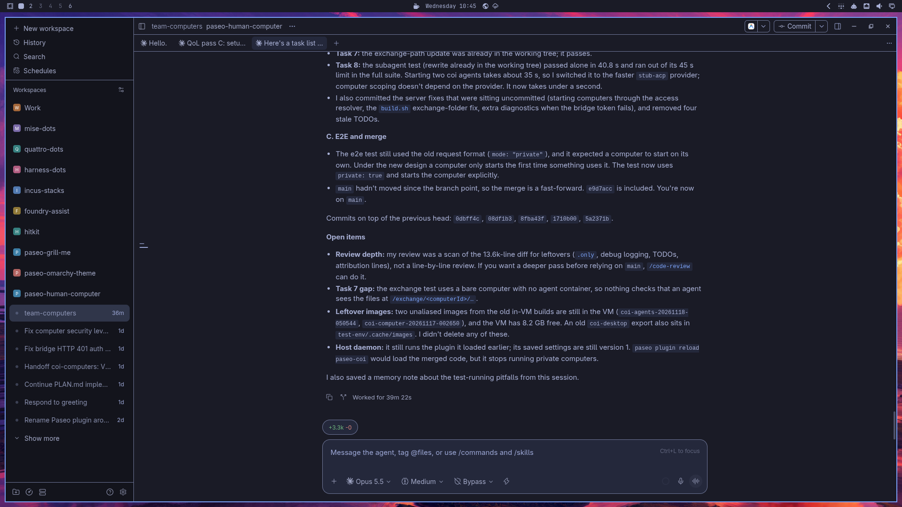
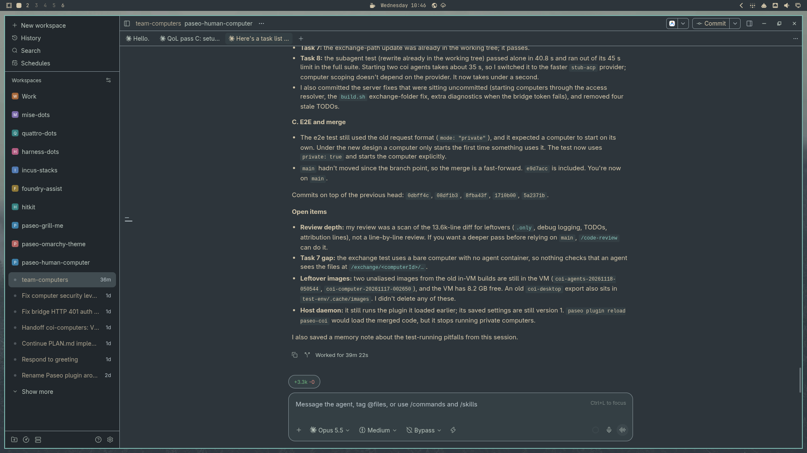

# Omarchy Theme for Paseo


A [Paseo](https://paseo.sh) plugin that adds a theme named **Omarchy**, which follows the active theme of the [Omarchy](https://omarchy.org) desktop on the daemon host. Switch your desktop theme and Paseo switches with it, including light and dark appearance.

| Tokyo Night | Catppuccin Latte |
| --- | --- |
|  |  |
| **Everforest** | **Rose Pine** |
|  |  |

More screenshots: [Ristretto](assets/screenshots/ristretto.png), [Ethereal](assets/screenshots/ethereal.png), [Jade Horse](assets/screenshots/jade-horse.png), and the [settings screen](assets/screenshots/settings-lumon.png) (Lumon).

## Features

- **Live sync.** The daemon watches Omarchy's theme state and pushes the new palette to every connected app as soon as the desktop theme changes.
- **Readable on every theme.** Colors are adjusted where needed to meet WCAG 2.2 Level AA contrast for text, accents, borders and focus rings. Missing secondary colors are derived from the theme's background and foreground.
- **Per-device choice.** The theme appears under Settings → Appearance. Each device selects it independently, so devices that keep a built-in theme are unaffected.
- **Status screen.** Settings → Omarchy theme shows the synced theme name, generation, last sync time and contrast diagnostics.

## Requirements

- Paseo 0.16.1 or later
- A Paseo daemon running on an Omarchy host. On hosts without Omarchy the plugin loads but contributes no theme.

## Installation

Plugins must be enabled first, in Settings → Plugins.

Install from GitHub:

```sh
paseo plugin add github:r3b1s/paseo-omarchy-theme
```

Or paste `github:r3b1s/paseo-omarchy-theme` into Settings → Plugins → Plugin source.

Then open Settings → Appearance and select **Omarchy**.

## Privacy

The plugin only reads these files under `$XDG_STATE_HOME/omarchy/current` (default `~/.local/state/omarchy/current`):

- `theme.name`
- `theme.generation`
- `theme/colors.toml`

It watches that directory for changes and re-reads it every 30 seconds as a fallback. It writes no files, runs no external commands and makes no network requests.

## Development

```sh
npm install
npm run typecheck
npm test
```

To try local changes, install the working copy on a daemon host:

```sh
paseo plugin add /path/to/paseo-omarchy-theme
```

## License

[MIT](LICENSE)
